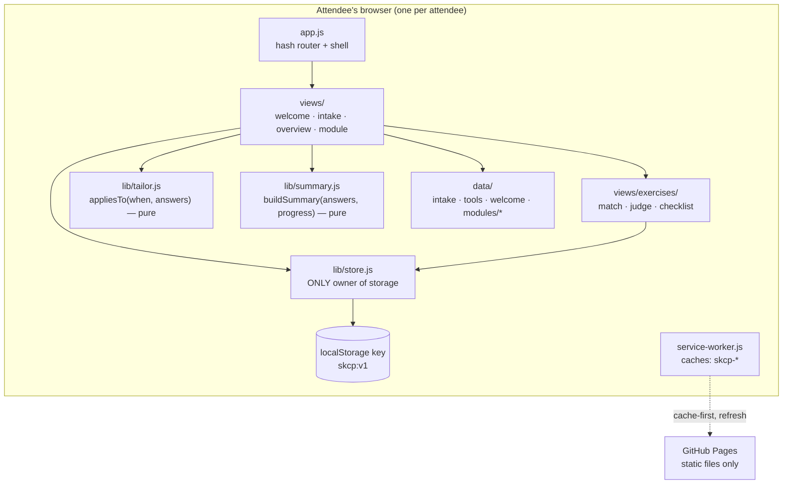

# Implementation Plan: Spec Kitty Class Prep Track

**Branch**: `feat/spec-kitty-class-prep-track` | **Date**: 2026-10-26 | **Spec**: [spec.md](spec.md)
**Input**: Feature specification from `kitty-specs/spec-kitty-class-prep-track-01M5VY73/spec.md`

## Summary

A standalone static website that prepares attendees for the Spec Kitty class. A welcome page leads into a five-question intake. The answers tailor one shared set of content, so each attendee sees only the setup steps for their operating system, chip, device situation and AI coding tool. Four short modules follow (Words you'll hear, Vibe coding vs spec-driven, Get set up, Ready check), plus an optional terminal primer. The ready check ends with a copyable one-line setup summary for the trainer.

The technical approach is deliberately small. It uses vanilla HTML/CSS/JS with native ES modules, no build step and no dependencies, deployed by pushing to GitHub Pages. Content lives in data files whose blocks carry a `when` label, and a single pure function decides whether a block applies to the attendee's answers. All per-attendee state is one storage entry under an app-specific key. One module owns that entry, which gives per-attendee and per-app isolation without any server.

## Planning Decisions

| Decision | Answer | Record |
|----------|--------|--------|
| Tech stack | Vanilla HTML/CSS/JS, native ES modules, no build step, offline-capable | DM-01M5VYBPB8AK5FJP1071488HG9 |
| Access | Open to anyone with the link, no passphrase | DM-01M5VYBRKQP26GTMKW59AV37NF |
| Engineering alignment | Confirmed by the user on 2026-10-26 (see below) | this plan |

**Engineering alignment (confirmed)**: single-page static site with hash routes. Data-driven content with `when` labels evaluated by one pure tailoring function. One storage entry (`skcp:v1`) owned by one module. "Start fresh" deletes only that entry. The service worker uses `skcp-` prefixed caches and deletes only its own. Three new exercise engines (match, judge, checklist). The setup summary is built from the answers and copied with a fallback. An in-browser test page covers the tailoring rule across every intake combination, and a manual quickstart checklist covers the rest.

## Technical Context

**Language/Version**: JavaScript ES2022 (native ES modules), HTML5, CSS3. No transpilation.
**Primary Dependencies**: none. No framework, no npm packages, no CDN scripts. Fonts are self-hosted or a system stack (decided at implementation; no third-party font CDN, to keep NFR-005's "no requests carry data" trivially true and the app offline-capable).
**Storage**: the browser's `localStorage`, exactly one key, `skcp:v1`, holding one JSON record (see [contracts/store-contract.md](contracts/store-contract.md)). Memory-only fallback when storage is unavailable.
**Testing**: `tests/index.html`, an in-browser test page with no framework. It runs assertions against the pure modules (`tailor.js`, `summary.js`, `store.js` with an injected fake storage) and reports pass/fail on the page. It includes exhaustive coverage of every intake combination for NFR-006 and SC-003. Everything else is verified manually against [quickstart.md](quickstart.md) in the browser preview.
**Target Platform**: current evergreen browsers (Chrome, Edge, Firefox, Safari) on desktop and phone. Hosted at `https://<user>.github.io/<repo>/` (sub-path), so every URL is relative.
**Project Type**: single static web app.
**Performance Goals**: welcome readable within 2 s on broadband on mid-range hardware (NFR-010). Total shipped payload under 300 KB excluding icons.
**Constraints**: offline after first visit (NFR-009); 360 px wide without horizontal scroll (NFR-008); zero network requests carrying answers or progress (NFR-005); never reads or writes another app's storage or caches on the shared `github.io` origin (NFR-004).
**Scale/Scope**: one class of roughly 5-50 attendees, each on their own device. Pages: welcome, intake, overview, 5 modules. 3 exercise engines. About 13 tool entries.

## Charter Check

*GATE: Must pass before Phase 0 research. Re-check after Phase 1 design.*

**Skipped: no charter exists in this repository** (`spec-kitty charter context --action plan` reports `missing`). The project can add one later with `/spec-kitty.charter`. In its absence the plan follows the user's explicit decisions above and the spec's constraints (C-001 to C-007), which all pass:

- C-001 standalone: own repo, no imports from the onboarding lab. **Pass.**
- C-002 static hosting: no server, accounts, database or analytics. **Pass.**
- C-006 link, don't copy: tool installs are links in `js/data/tools.js`. **Pass.**

**Post-design re-check**: the Phase 1 artifacts introduce no server component, dependency or cross-app storage access. **Pass.**

## Supply-Chain Check

No dependency is added, upgraded or removed: the app ships zero third-party code. Registry authenticity, package freshness and lifecycle scripts therefore do not apply, and no adversarial-squad pass is required. If an implementer later proposes any dependency (including a CDN font or script), that is a plan change requiring a new decision.

## Architecture



### Routes

| Hash route | View | Notes |
|------------|------|-------|
| `#/` | welcome, or overview | First visit (no answers) shows the welcome. With answers, the overview shows; the welcome stays reachable at `#/welcome`. |
| `#/welcome` | welcome | FR-001 |
| `#/intake` | intake | FR-002, FR-003, FR-005 (also "Change my answers") |
| `#/course` | overview | FR-007, FR-021: modules, progress, suggested next step, early-stop banner (FR-006) |
| `#/m/:id` | module | Renders tailored blocks plus the module's exercise |

Module ids: `terminal` (optional), `words`, `spec-driven`, `setup`, `ready`.

**Route guard**: `#/course` and every `#/m/:id` redirect to `#/intake` while the store has no valid answers. A deep link or an old bookmark therefore never shows untailored setup steps for every OS at once (FR-004).

**Not in the app's navigation**: `tests/` is reachable by URL for the trainer, but it is never linked from the UI and never precached.

### Tailoring

Each content block may carry `when: { os?, chip?, device?, tool?, experience? }`, where each value is an array of allowed answers. `appliesTo(when, answers)` returns true when every listed dimension matches. Absent `when` or an absent dimension means "everyone". `chip: "unsure"` matches every chip-labelled block, and the views show chip labels so attendees can pick the right one. The full rule is in [contracts/tailoring-contract.md](contracts/tailoring-contract.md).

### Isolation model

| Threat | Mitigation |
|--------|-----------|
| Two attendees on different devices | Nothing leaves the browser (NFR-005). There's nothing to mix. |
| Two attendees on one device/browser | "Not you? Start fresh" removes `skcp:v1` and routes to the intake (FR-023). |
| Other apps on the same `github.io` origin (onboarding lab, rijbewijs app) | Exactly one storage key with a unique `skcp:` prefix. The app never calls `localStorage.clear()` and never enumerates foreign keys. Caches are named `skcp-v<N>`, and `activate` deletes only `skcp-` caches. |
| Another app's service worker deleting *our* caches (the onboarding lab's SW deletes every cache not named its own) | The fetch handler falls back to the network and re-populates the cache, so the worst case is losing offline mode until the next online visit. Recorded as risk R-02. |

## Project Structure

### Documentation (this mission)

```
kitty-specs/spec-kitty-class-prep-track-01M5VY73/
├── spec.md
├── plan.md              # this file
├── research.md          # Phase 0
├── data-model.md        # Phase 1
├── quickstart.md        # Phase 1: manual verification script
├── contracts/           # Phase 1
│   ├── store-contract.md
│   ├── tailoring-contract.md
│   ├── content-schema.md
│   └── exercise-engine-contract.md
└── tasks.md             # created later by /spec-kitty.tasks
```

### Source Code (repository root)

```
index.html                      # shell: header, <main>, module script tag
manifest.json                   # installable/offline metadata
service-worker.js               # skcp- caches only
css/
└── style.css                   # design tokens (light + dark), layout, components
icons/                          # app icons
js/
├── app.js                      # hash router, shell chrome, SW registration
├── lib/
│   ├── store.js                # ONLY module that touches localStorage
│   ├── tailor.js               # pure: appliesTo(), visibleBlocks(), earlyStop(), suggestedNext()
│   ├── summary.js              # pure: buildSummary()
│   ├── clipboard.js            # copy with select-text fallback
│   └── enhance.js              # copy buttons on command blocks
├── data/
│   ├── intake.js               # questions, options, chip-finding hints
│   ├── tools.js                # supported AI coding tools: name, cost, install URL, command style
│   ├── welcome.js              # what Spec Kitty is, agenda, what to bring
│   ├── setup/                  # setup-module block sources, composed by modules/setup.js
│   │   ├── platform-blocks.js  # Git + Python per OS/chip
│   │   ├── tool-blocks.js      # one block per tool + "help me choose" + "other"
│   │   └── support-blocks.js   # agent check, work-device guidance, pipx/uv head start
│   └── modules/
│       ├── index.js            # ordered module list
│       ├── terminal.js         # optional primer (per-OS blocks)
│       ├── words.js            # Module 1 + match exercise config
│       ├── spec-driven.js      # Module 2 + judge exercise config
│       ├── setup.js            # Module 3: composes data/setup/* in display order
│       └── ready.js            # Module 4 + checklist config
└── views/
    ├── welcome-view.js
    ├── intake-view.js
    ├── overview-view.js
    ├── module-view.js          # renders tailored blocks + mounts the exercise
    └── exercises/
        ├── match.js
        ├── judge.js
        └── checklist.js        # also renders the setup-summary action on the ready module
tests/
├── index.html                  # in-browser test runner page
├── runner.js                   # ~40-line assert/report helper
├── tailor.test.js              # unit cases for the tailoring rules
├── coverage.test.js            # exhaustive intake-combination coverage (WP08)
├── summary.test.js
└── store.test.js               # with injected fake storage
README.md                       # run locally, deploy to GitHub Pages, update tool list
.claude/launch.json             # local static server for the browser preview
```

**Structure Decision**: one static web app at the repository root, so GitHub Pages serves it from `main` / root with no build. Logic that must be correct (tailoring, summary, storage isolation) lives in small pure modules under `js/lib/`, so the test page can exercise it without a DOM. Content lives under `js/data/`, so updating the course never touches view code.

## Complexity Tracking

No charter violations to justify.

## Risks

| ID | Risk | Mitigation |
|----|------|-----------|
| R-01 | Tool facts (cost models, install links) go stale after the build. | C-006: link to official docs only. The `tools.js` header records the date it was last checked. The README explains how to update it. |
| R-02 | Another app on the same origin deletes our caches. | Network fallback re-populates the caches (see Isolation model). Offline mode is a Low-priority NFR. |
| R-03 | Platform install steps are wrong for some combination. | Exhaustive coverage test (no dead ends, exactly one OS's steps). Quickstart spot-checks four real combinations. |
| R-04 | Copying to the clipboard is refused (older browsers, insecure context). | `clipboard.js` falls back to selecting the text in a read-only field (FR-020). |
| R-05 | Storage unavailable (private mode). | `store.js` falls back to memory and exposes `isPersistent()`. The shell shows a one-line notice (edge case in spec). |
| R-06 | Session details and trainer contact unknown at build time. | `welcome.js` `session` fields are optional and render nothing when empty. The trainer fills them in before sharing the link. |

## Plan Review (2026-10-26)

A self-review against spec.md found every FR, NFR and C referenced in the planning artifacts. It also found five gaps, fixed in this revision:

1. **`tool: "other"` had no setup block**, which would have been a dead end and failed the coverage test. Added an "other tool" block rule in the tailoring contract.
2. **A deep link to a module before the intake showed every OS's steps.** Added a route guard that redirects to the intake.
3. **The suggested next step could point early-stop attendees at setup.** `suggestedNext` now skips setup and ready for them.
4. **Ready-check items could be impossible** for some combinations (e.g. "logged in" with no tool chosen). Added coverage rule 5.
5. **There was nowhere for session date, place or the trainer's contact.** The trainer-contact messages need the latter. Added optional `session` fields to the welcome content.

Also clarified that `tests/` is not linked or precached.

## Implementation Concern Map

> Implementation concerns are not work packages. `/spec-kitty.tasks` turns them into WPs.

### IC-01 — App shell, routing and visual system

- **Purpose**: the frame every page renders in: hash router, header with course title and a "Change my answers / Start fresh" menu, design tokens for light and dark, 360 px layout.
- **Relevant requirements**: FR-007 (overview frame), NFR-008, NFR-010
- **Affected surfaces**: `index.html`, `css/style.css`, `js/app.js`, `.claude/launch.json`
- **Sequencing/depends-on**: none
- **Risks**: design should feel distinct but stay light. One display face plus a body face and tokens, no heavy imagery.

### IC-02 — Storage and isolation

- **Purpose**: the single owner of per-attendee state, plus the guarantees that nothing mixes between attendees or apps.
- **Relevant requirements**: FR-023, FR-024, FR-005 (persisting changes), NFR-003, NFR-004, NFR-005
- **Affected surfaces**: `js/lib/store.js`, `tests/store.test.js`
- **Sequencing/depends-on**: none (pure module, testable alone)
- **Risks**: must never call `localStorage.clear()` or touch keys outside `skcp:v1`. Must degrade to memory without throwing.

### IC-03 — Intake and tailoring engine

- **Purpose**: collect the five answers and decide what each attendee sees, including early stop and the suggested next step.
- **Relevant requirements**: FR-002, FR-003, FR-004, FR-005, FR-006, FR-021, NFR-002, NFR-006, SC-003
- **Affected surfaces**: `js/data/intake.js`, `js/lib/tailor.js`, `js/views/intake-view.js`, `js/views/overview-view.js`, `tests/tailor.test.js`, `tests/coverage.test.js`
- **Sequencing/depends-on**: IC-02 (answers are persisted through the store)
- **Risks**: the exhaustive combination test depends on the setup content (IC-05) existing. Write the rule and unit tests first, then extend the coverage test once IC-05 lands.

### IC-04 — Vocabulary modules and their exercises

- **Purpose**: Module 1 (Words you'll hear) with the match exercise, and Module 2 (Vibe coding vs spec-driven) with the judge exercise. All tool-neutral.
- **Relevant requirements**: FR-008, FR-009, FR-010, FR-011, FR-025, NFR-007, C-005
- **Affected surfaces**: `js/data/modules/words.js`, `js/data/modules/spec-driven.js`, `js/views/module-view.js`, `js/views/exercises/match.js`, `js/views/exercises/judge.js`
- **Sequencing/depends-on**: IC-01 (shell), IC-02 (exercise progress)
- **Risks**: definitions of doctrine, charter and agent profile must match how Spec Kitty uses those terms (see research.md R0-03).

### IC-05 — Setup content and terminal primer

- **Purpose**: the per-platform heart of the course: Git (with identity), Python 3.11+ (with per-OS traps), the chosen AI tool (cost, official link, log in once), the generic agent check, work-device guidance, the optional pipx/uv step, and the optional terminal primer.
- **Relevant requirements**: FR-012, FR-013, FR-014, FR-015, FR-016, FR-017, FR-018, FR-022, NFR-006, C-004, C-006, C-007
- **Affected surfaces**: `js/data/modules/setup.js`, `js/data/modules/terminal.js`, `js/data/tools.js`
- **Sequencing/depends-on**: IC-03 (block labels must use the intake's answer values)
- **Risks**: R-01, R-03. Each OS × chip combination needs install **and** verify steps or the early-stop message.

### IC-06 — Welcome, ready check and setup summary

- **Purpose**: the course's first and last pages: welcome (what Spec Kitty is, agenda, what to bring) and ready check (checklist plus copyable setup summary).
- **Relevant requirements**: FR-001, FR-019, FR-020, SC-002, SC-004
- **Affected surfaces**: `js/data/welcome.js`, `js/views/welcome-view.js`, `js/data/modules/ready.js`, `js/views/exercises/checklist.js`, `js/lib/summary.js`, `js/lib/clipboard.js`, `tests/summary.test.js`
- **Sequencing/depends-on**: IC-02, IC-03
- **Risks**: R-04. The summary must include only intake answers and ready-check status, never free text.

### IC-07 — Offline, deployment and verification

- **Purpose**: make it installable and offline (NFR-009), deployable to GitHub Pages, and verifiable: test page runner plus quickstart pass.
- **Relevant requirements**: NFR-009, NFR-004 (cache isolation), C-002, all SCs via quickstart
- **Affected surfaces**: `service-worker.js`, `manifest.json`, `icons/`, `tests/index.html`, `tests/runner.js`, `README.md`
- **Sequencing/depends-on**: IC-01 to IC-06 for the final precache list and end-to-end pass
- **Risks**: R-02. Every new file must be added to the precache list, and the cache name bumped on each release.
